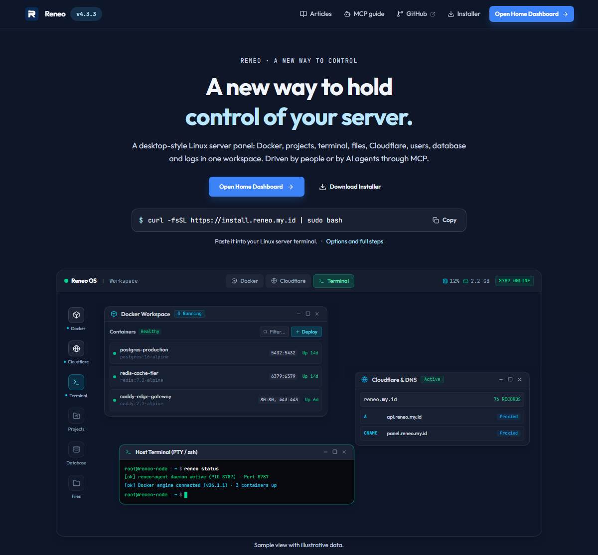
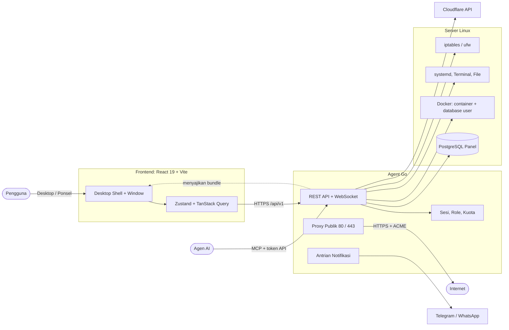

<div align="center">

# Panel Reneo

### Panel Kontrol Server Linux Bergaya Desktop

[](https://github.com/friskipradana/y-panel/releases/latest)
[](LICENSE)
[](https://go.dev)
[](https://react.dev)
[](https://www.typescriptlang.org)
[](https://vite.dev)
[](https://tailwindcss.com)
[](https://www.postgresql.org)
[](https://www.docker.com)

<p align="center">
  Panel server yang ringan, self-hosted, dan nyaman dipakai. Docker, project, database, file, terminal, Cloudflare, pengguna, dan agen AI (lewat MCP) dalam satu workspace visual, dengan tampilan desktop dan tampilan ponsel. Satu perintah untuk memasang.
</p>



[Fitur](#-fitur) • [Arsitektur](#-arsitektur--stack) • [Pasang](#-pasang) • [Pengembangan](#-pengembangan) • [Struktur](#-struktur-repository) • [Dokumentasi](#-dokumentasi)

> Pembaruan kendali. Kesini aja. (filosofi di [docs/FILOSOFI-RENEO.md](docs/FILOSOFI-RENEO.md))

---

</div>

## 🌟 Fitur

| Fitur                             | Deskripsi                                                                                                                                                                                                                                                                                                                         |
| :-------------------------------- | :-------------------------------------------------------------------------------------------------------------------------------------------------------------------------------------------------------------------------------------------------------------------------------------------------------------------------------- |
| 🖥️ **Desktop dan ponsel**         | Taskbar, dock, window manager, widget (jam, sistem, jaringan, grafik CPU, sticky note, ping), dan palet perintah (Ctrl+K). Di bawah 768px otomatis memakai layout ponsel: satu aplikasi layar penuh dan navigasi bawah. `?ui=mobile` atau `?ui=desktop` memaksa sekali muat. Tema terang dan gelap, bahasa Indonesia dan Inggris. |
| 🐳 **Docker**                     | Container, image, network, volume, dan template compose. Deploy dari image atau compose, log realtime lewat WebSocket, start, stop, restart, perbarui, hapus, dan audit runtime.                                                                                                                                                  |
| 📦 **Project**                    | Tipe `static` (SPA fallback), `nodejs`, `python`, `php`, `custom`, dan `stack` (beberapa proses di satu alamat). Perintah install, build, dan start sendiri (npm, Bun, pnpm, Yarn), variabel lingkungan terenkripsi, dan bangun ulang. Direktori kerja dikunci ke home pemilik.                                                   |
| 🗄️ **Database**                   | PostgreSQL, MySQL, MariaDB, MongoDB, dan Redis sebagai container milik user, dengan kuota per akun. Kelola tabel, konsol SQL, user dan izin, serta password dari panel. Akses per database: hanya localhost (bawaan) atau IP tertentu lewat firewall agent.                                                                       |
| 🛡️ **Firewall** | Jendela khusus superadmin untuk ufw: aturan bernomor (tambah dan hapus), port yang mendengarkan beserta jangkauannya, kebijakan bawaan, dan tingkat log. SSH, port panel, dan port web dijaga: perubahan yang bisa mengunci Anda meminta konfirmasi. |
| ☁️ **Cloudflare**                 | Token per user, tunnel, DNS, aturan redirect, dan publikasi project lewat tunnel.                                                                                                                                                                                                                                                 |
| 🌐 **IP publik tanpa tunnel**     | Proxy bawaan di port 80 dan 443 dengan sertifikat Let's Encrypt otomatis, atau lewat nginx atau Apache yang sudah ada. Membuka port web di ufw bila ufw aktif.                                                                                                                                                                    |
| 🛒 **Hosting dan pembayaran**     | Paket, promo, voucher, pemesanan mandiri, faktur, subdomain dan domain pembeli, serta pembaca notifikasi bank lewat ponsel Android.                                                                                                                                                                                               |
| 🔔 **Notifikasi**                 | Telegram dan WhatsApp untuk kabar keamanan, pesanan, dan paket, dengan antrian pengiriman dan teks pesan yang bisa diubah.                                                                                                                                                                                                        |
| 🤖 **MCP untuk agen AI**          | Server MCP di `/mcp` dengan token API. Tool mengikuti role. Panduan publik di `/docs/mcp`, dan [docs/mcp.md](docs/mcp.md).                                                                                                                                                                                                        |
| 💻 **Terminal, file, sistem**     | Terminal host (Xterm.js), file manager dengan unggah dan editor Monaco, monitoring host, dan pembaruan panel dari UI atau CLI.                                                                                                                                                                                                    |
| 🛠️ **Alat pengembangan per akun** | Node.js, Bun, pm2, pnpm, Yarn, dan uv dipasang di folder akun sendiri tanpa sudo.                                                                                                                                                                                                                                                 |
| 👥 **Pengguna dan akses**         | Role `superadmin`, `admin`, `user` dengan kuota project, tunnel, database, disk, CPU, dan memori. Akun demo hanya-baca.                                                                                                                                                                                                           |
| 📚 **Docs dan artikel publik**    | Window Docs dengan markdown. Artikel yang terbit dan terbuka untuk umum dibaca tanpa login. Artikel resmi tersinkron ke setiap panel dari repository ini.                                                                                                                                                                         |

### Mudah ditemukan mesin pencari dan AI

Halaman publik (`/`, `/articles`, `/docs/mcp`) memuat meta tag, Open Graph, JSON-LD, dan konten cadangan tanpa JavaScript. Agent juga menyajikan `/robots.txt`, `/sitemap.xml`, `/llms.txt`, dan `/articles/{slug}.md`. Atur `RENEO_PUBLIC_URL=https://panel.domain-anda.com` agar tautan kanonik dan sitemap memakai alamat publik yang benar.

---

## ⚡ Arsitektur & Stack



Diagram rinci tiap alur (permintaan API, proses project, akses database, domain publik, hosting dan notifikasi, pemasangan) ada di [docs/architecture/system-architecture.md](docs/architecture/system-architecture.md).

### 💻 Frontend

- **Framework**: React 19, TypeScript, Vite
- **State**: Zustand dan TanStack Query
- **Styling**: Tailwind v4 dan SCSS modul
- **Komponen**: Xterm.js, Monaco, Framer Motion, Lucide

### ⚙️ Backend

- **Bahasa**: Go
- **Data**: PostgreSQL dengan migrasi SQL berversi
- **Integrasi**: Docker CLI, systemd dan journalctl, Cloudflare API, GitHub Releases

---

## 🚀 Pasang

Di server Linux (Ubuntu, Debian, RHEL dan turunannya; amd64 atau arm64):

```bash
curl -fsSL https://panel.reneo.my.id/install | sudo bash
```

Lalu buka `http://IP-SERVER:8787` dan selesaikan penyiapan pertama untuk membuat akun superadmin.

Opsi installer: `--bind ADDR`, `--yes`, `--skip-start`. Detail: [Installer Architecture](docs/installer-architecture.md).

### 🧰 Perintah `reneo`

| Perintah                                           | Fungsi                                                                                                                                                                              |
| :------------------------------------------------- | :---------------------------------------------------------------------------------------------------------------------------------------------------------------------------------- |
| `systemctl status reneo`                           | Status service                                                                                                                                                                      |
| `journalctl -u reneo -f`                           | Log langsung                                                                                                                                                                        |
| `sudo reneo`                                       | Menu pengelolaan (password, port, origin)                                                                                                                                           |
| `sudo reneo status` / `start` / `stop` / `restart` | Ringkasan dan kendali service (`status` keluar 3 bila tidak sehat)                                                                                                                  |
| `sudo reneo logs -f`                               | Log langsung (`-n N` jumlah baris)                                                                                                                                                  |
| `sudo reneo doctor`                                | Periksa service, port, kesehatan, database, Docker, firewall database, dan disk                                                                                                     |
| `sudo reneo info` / `config [KEY]` / `version`     | Alamat dan lokasi berkas, isi konfigurasi (rahasia disamarkan), versi                                                                                                               |
| `sudo reneo seed-plans`                            | Pasang paket hosting contoh (Starter, Pro, Bisnis). Tanpa `--force` hanya menambah yang belum ada, `--force` menimpa yang berbeda setelah konfirmasi, `--dry-run` hanya menampilkan |
| `sudo reneo check-update` / `sudo reneo update`    | Cek dan terapkan pembaruan                                                                                                                                                          |
| `sudo reneo help`                                  | Semua perintah                                                                                                                                                                      |
| `sudo bash /opt/reneo/installer/uninstall.sh`      | Mencopot                                                                                                                                                                            |

CLI `reneo` hanya untuk root dan superadmin panel lewat sudo: berkasnya `root:root` mode 750, akun admin dan user panel tidak punya sudo, dan akun `panel-*` tanpa izin sudo superadmin ditolak. Perintah pemeliharaan agent (`reset-primary-password`, `migrate`, `seed-plans`) juga menolak pengguna selain root. Perintah yang mengubah data dicatat di journal (`journalctl -t reneo-cli`).

### 🔧 Konfigurasi environment

Nama `RENEO_*` diterima di mana pun `PANEL_*` dipakai.

| Variabel                                                                                | Fungsi                                                       |
| :-------------------------------------------------------------------------------------- | :----------------------------------------------------------- |
| `PANEL_BIND_ADDR`                                                                       | Alamat dan port panel (bawaan `0.0.0.0:8787`)                |
| `PANEL_DATABASE_DSN`, `PANEL_SESSION_SECRET`                                            | Database panel dan rahasia sesi (diisi installer)            |
| `PANEL_ENCRYPTION_KEY`                                                                  | Kunci enkripsi token Cloudflare dan kredensial database user |
| `RENEO_PUBLIC_URL`                                                                      | Alamat publik untuk sitemap dan tautan kanonik               |
| `RENEO_DEMO_PASSWORD`, `RENEO_DEMO_USERNAME`                                            | Mengaktifkan akun demo hanya-baca                            |
| `RENEO_UPDATE_CHECK=false`                                                              | Mematikan cek pembaruan dan changelog GitHub                 |
| `RENEO_UPDATE_REPO`                                                                     | Repository GitHub sumber rilis                               |
| `RENEO_DOCS_SYNC=false`, `RENEO_DOCS_REPO`                                              | Mematikan atau mengganti sumber artikel resmi                |
| `PANEL_TERMINAL_ENABLED`, `PANEL_TERMINAL_ALLOW_REMOTE`, `PANEL_ADMIN_FILE_ROOT_ACCESS` | Pengerasan terminal dan file                                 |

### 👤 Akun demo

Isi `RENEO_DEMO_PASSWORD` di environment agent (opsional `RENEO_DEMO_USERNAME`, bawaan `demo`) lalu restart. Akun hanya membaca: desktop, widget, ringkasan sistem, dan daftar project dan container miliknya. Terminal, file, pengaturan, user, database, log, Cloudflare, dan semua aksi tulis ditolak, dan endpoint baru ditolak secara bawaan. Username dan password tampil di landing page, jadi pakai password yang tidak dipakai di tempat lain. Detail: [Security Hardening](docs/security-hardening.md).

---

## 🛠️ Pengembangan

Prasyarat: Go sesuai `go.mod`, [Bun](https://bun.sh) atau Node.js, Docker (untuk fitur Docker dan database), dan PostgreSQL.

```bash
bun install
bun run dev            # agent + UI
```

### Referensi perintah

| Perintah                                                       | Fungsi                                                                                       |
| :------------------------------------------------------------- | :------------------------------------------------------------------------------------------- |
| `bun run dev`                                                  | Jalankan agent Go dan UI Vite bersamaan                                                      |
| `bun run dev:agent`                                            | Hanya agent (`go run ./cmd/panel-agent`)                                                     |
| `bun run dev:ui`                                               | Hanya UI Vite                                                                                |
| `bun run build`                                                | Build frontend (`tsc -b` lalu `vite build`), harus tanpa warning                             |
| `bun run lint`                                                 | ESLint                                                                                       |
| `bun run check:ui`                                             | Validasi aturan UI, harus 0 error                                                            |
| `go test ./...`                                                | Tes backend                                                                                  |
| `bun run db:migrate` / `db:migrate:status` / `db:migrate:down` | Terapkan, lihat, atau mundurkan migrasi                                                      |
| `bun run db:migrate:create <nama>`                             | Buat berkas migrasi baru                                                                     |
| `bun run release:patch` / `release:minor` / `release:major`    | Rilis: validasi, perbarui CHANGELOG, buat tag, dan push. Workflow GitHub membangun installer |

Tes yang butuh PostgreSQL asli (alur pesanan, trial, domain, akses database) dilewati kecuali `REN_TEST_DATABASE_URL` diisi, misalnya `postgres://postgres@127.0.0.1:5432/postgres?sslmode=disable`. Tiap tes membuat dan menghapus database sendiri.

Aturan UI ada di [DESIGN.md](DESIGN.md) dan `.agents/rules/`. Ikon `Sparkles`, `Sparkle`, dan `WandSparkles` dilarang dan diperiksa oleh `check:ui`.

### Migrasi database

```bash
reneo-agent migrate create <nama>
reneo-agent migrate up
reneo-agent migrate status
reneo-agent migrate rollback
```

Panduan: [Database Migrations](docs/database-migrations.md).

### Deployment

```powershell
.\deploy\build.ps1 -HostName <host> -SshUsername <user> -SshPassword <password>
```

Skrip membangun frontend, membuat installer `.run`, mengunggah, memasang service, menjalankan migrasi, dan melakukan healthcheck.

---

## 📁 Struktur Repository

```txt
.
├── cmd/panel-agent/     # entrypoint agent Go
├── internal/            # paket backend
├── installer/           # installer Linux dan template service
├── deploy/              # script build dan deploy
├── docs/                # dokumentasi teknis, filosofi, dan artikel resmi (docs/articles)
├── public/              # aset statis frontend
├── src/                 # frontend React
├── scripts/             # release, validasi UI, ikon merek
├── CHANGELOG.md
└── README.md
```

Paket backend utama:

```txt
internal/
  accountusage/ pemakaian sumber daya per akun
  auth/         session dan role/capability
  cloudflare/   API, tunnel, daemon cloudflared
  config/       konfigurasi runtime
  crypto/       enkripsi rahasia
  database/     PostgreSQL dan migrasi
  docker/       container, image, network, deploy, log
  docsync/      artikel resmi dari GitHub
  httpserver/   API, middleware, SEO, penyajian frontend
  listquery/    cari, urut, dan filter tabel di backend
  mcp/          server MCP dan katalog tool
  metrics/      riwayat metrik host
  notify/       antrian notifikasi, Telegram, WhatsApp
  osuser/       akun Linux per user
  projects/     proses project, direktori kerja, environment
  publicproxy/  proxy publik di port 80 dan 443
  runtimepath/  nama dan path runtime (reneo/ypanel)
  listening/    port yang mendengarkan (ss)
  system/       statistik, log, pengaturan
  terminal/     sesi terminal
  toolchain/    alat pengembangan per akun
  ufw/          status ufw dan pembukaan port
  updater/      cek dan terapkan pembaruan, GitHub Releases
  userdb/       database milik user (container), akses, dan administrasinya
  users/        aturan akun dan kuota
  webserver/    nginx dan Apache sebagai pelayan domain
```

---

## 🔒 Keamanan

Panduan lengkap: [Security Hardening](docs/security-hardening.md). Poin penting:

- aksi sensitif dilindungi role dan capability di backend, dengan audit
- proses project tidak mewarisi environment agent dan terkunci pada direktori home pemiliknya
- kredensial database user dienkripsi dan hanya dibuka untuk pemiliknya
- database user hanya terbuka di localhost kecuali pemiliknya mengizinkan IP tertentu, yang dijaga aturan firewall agent
- log sistem, database internal, dan runtime Reneo hanya untuk superadmin

---

## 📚 Dokumentasi

- [Artikel resmi](docs/articles) (disinkronkan ke setiap panel)
- [Installer Architecture](docs/installer-architecture.md)
- [MCP](docs/mcp.md)
- [IP Publik](docs/IP-PUBLIK.md)
- [Notifikasi dan kanal](docs/NOTIFIKASI-KANAL.md)
- [Database Migrations](docs/database-migrations.md)
- [Security Hardening](docs/security-hardening.md)
- [Arsitektur Sistem](docs/architecture/system-architecture.md) (diagram rinci)
- [Repository Structure](docs/architecture/repository-structure.md)
- [Backend Go Structure](docs/architecture/backend-go-structure.md)
- [Frontend Structure](docs/architecture/frontend-structure.md)

---

## 📄 Lisensi

Reneo menggunakan **Reneo Public Use License**.

Semua orang boleh mengakses, mengunduh, memasang, menjalankan, dan memakai Reneo. Namun perubahan pada repository resmi, push commit, merge, release, atau tindakan maintainer hanya boleh dilakukan oleh owner atau contributor yang memiliki izin. Detail lengkap di [LICENSE](LICENSE). Daftar kontributor ada di [halaman contributors GitHub](https://github.com/friskipradana/y-panel/graphs/contributors).

<div align="center">
  <sub>Dibuat untuk kendali server yang ringan dan jelas • Reneo</sub>
</div>
