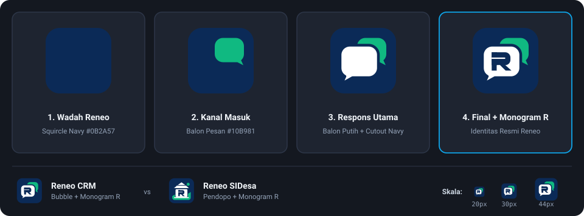
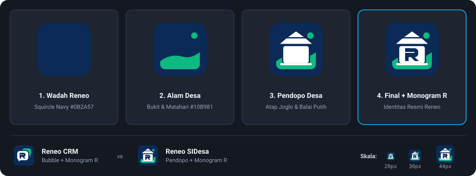

# Filosofi & Sistem Identitas Logo Produk Reneo

Dokumen ini menjadi acuan sistem identitas visual bagi seluruh aplikasi resmi dalam ekosistem **Reneo** (turunan dari [FILOSOFI-RENEO.md](./FILOSOFI-RENEO.md)).

---

## 1. Prinsip Keluarga Logo Reneo

Setiap layanan resmi Reneo (*first-party service*) harus langsung dikenali sebagai bagian dari satu keluarga produk, sekaligus langsung menjelaskan domain kerjanya hanya dari siluet:

1. **Satu Wadah**: `viewBox="0 0 512 512"`, squircle `432 × 432` (`x=40, y=40, rx=92`) berwarna **Reneo Navy (`#0B2A57`)**.
2. **Tiga Warna Inti**:
   - **Reneo Navy (`#0B2A57`)** — fondasi kendali, ketenangan, dan kredibilitas.
   - **Reneo Emerald (`#10B981`)** — elemen hidup/aksen domain (balasan percakapan di CRM, alam & matahari desa di SIDesa).
   - **Putih Bersih (`#FFFFFF`)** — objek utama layanan yang menjadi fokus mata.
3. **Satu Tanda Pengenal (Monogram "R")**: Geometri huruf **"R"** khas Reneo (primitif SVG murni dengan celah horizontal di tengah mangkuk) ditanamkan di jantung objek putih.
4. **Tahan Skala Kecil**: Tanpa detail garis tipis atau gradient dekoratif agar tetap tajam dari `16px` (favicon) sampai `512px`.

---

## 2. Perbandingan Pembentukan Logo Produk

### A. Reneo CRM (`public/icons/apps/reneo-crm.svg`)
**Tema**: Percakapan dua arah & manajemen relasi pelanggan.

| Tahap | Lapisan Visual | Warna | Filosofi |
| :--- | :--- | :--- | :--- |
| **1. Wadah** | Squircle dasar (`rx=92`) | `#0B2A57` | Ruang kerja terpusat untuk semua kanal & data pelanggan |
| **2. Konteks** | Balon pesan belakang (kanan atas) | `#10B981` | Pesan masuk & kanal aktif (WhatsApp, web) yang dinamis |
| **3. Objek Utama** | Balon pesan utama (kiri depan, stroke navy `18`) | `#FFFFFF` | Respons tim yang jernih dan terstruktur |
| **4. Identitas** | Monogram **"R"** (`translate(83.3, 116.5) scale(0.56)`) | `#0B2A57` | Kendali relasi pelanggan di dalam mesin Reneo |

Dokumentasi lengkap di repositori CRM: `crm-services/docs/FILOSOFI-LOGO.md`.

---

### B. Reneo SIDesa (`public/icons/apps/reneo-sidesa.svg`)
**Tema**: Pelayanan publik desa, transparansi, dan potensi wilayah Nusantara.

| Tahap | Lapisan Visual | Warna | Filosofi |
| :--- | :--- | :--- | :--- |
| **1. Wadah** | Squircle dasar (`rx=92`) | `#0B2A57` | Tata kelola pemerintahan desa yang stabil dan terpercaya |
| **2. Konteks** | Perbukitan terasering bawah & matahari kanan atas | `#10B981` | Kesuburan alam, pertanian, UMKM, dan harapan kemajuan desa |
| **3. Objek Utama** | Atap Joglo bertingkat + Balai Pendopo + umpak (stroke navy `10`) | `#FFFFFF` | Balai desa sebagai pusat pelayanan warga dan keterbukaan data |
| **4. Identitas** | Monogram **"R"** (`translate(130.2, 174.2) scale(0.48)`) | `#0B2A57` | Operasional desa yang ditenagai ekosistem Reneo |

Dokumentasi lengkap di repositori SIDesa: `sidesa-services/docs/FILOSOFI-LOGO.md`.

---

## 3. Aturan Menambah Logo Produk Reneo Baru

Jika ke depan ekosistem Reneo menambah aplikasi resmi baru (misalnya POS, HRIS, atau Akuntansi):
1. Mulai dari **Squircle Navy `#0B2A57`** (`x=40 y=40 w=432 h=432 rx=92`).
2. Tambahkan **1 elemen konteks domain** berwarna **Emerald `#10B981`**.
3. Bentuk **1 siluet objek utama** berwarna **Putih `#FFFFFF`** dengan garis pemisah `stroke="#0B2A57"`.
4. Sematkan **Monogram "R" Reneo** yang sama (skala `0.45–0.58`) di dalam area putih objek utama.
5. Uji keterbacaan pada `16px`, `24px`, dan `32px` di tema terang maupun gelap, lalu daftarkan di `src/components/common/AppIcon.tsx`.
