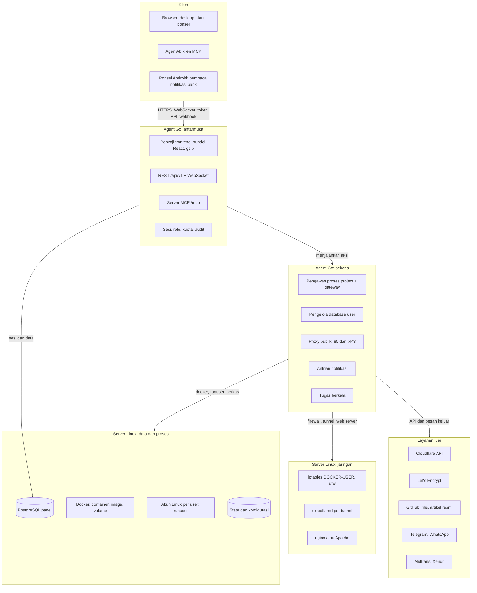
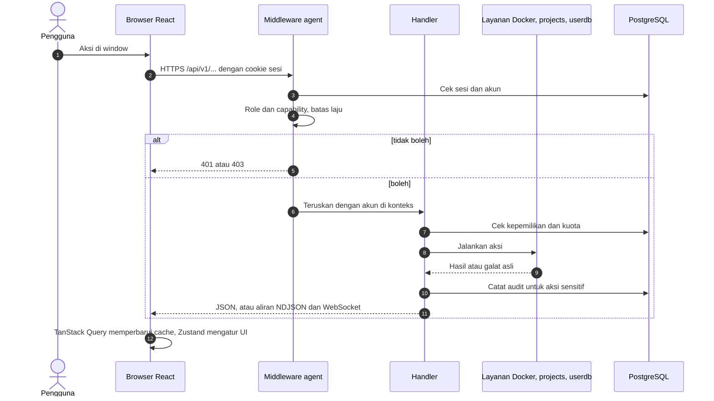
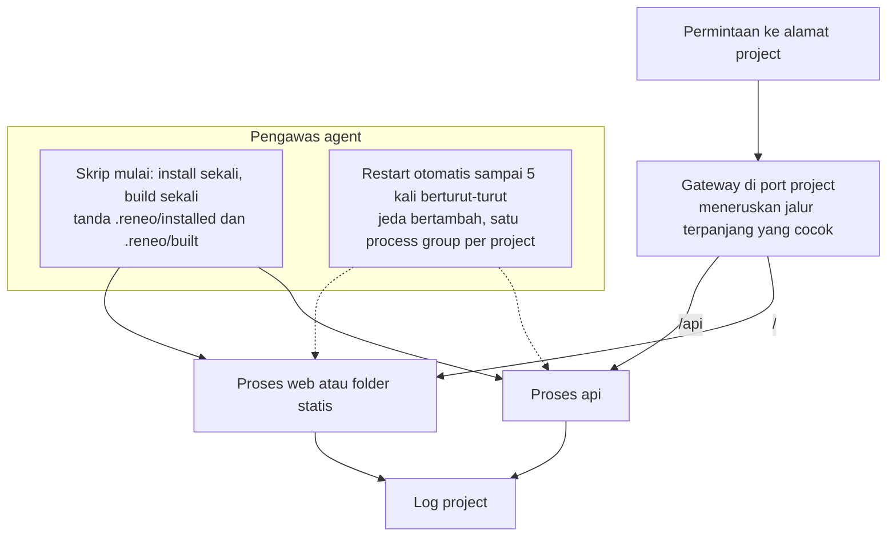
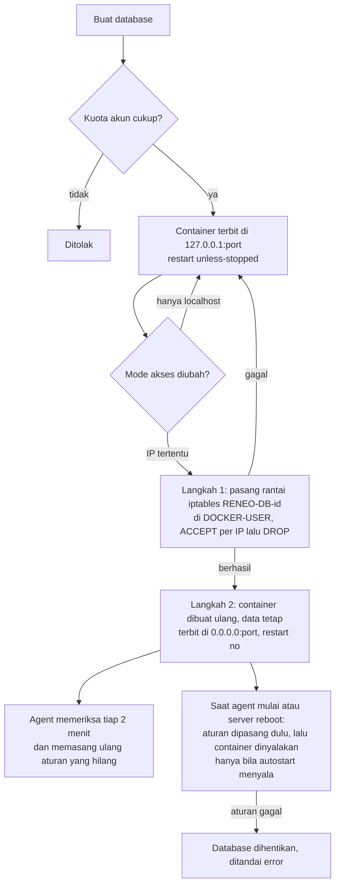
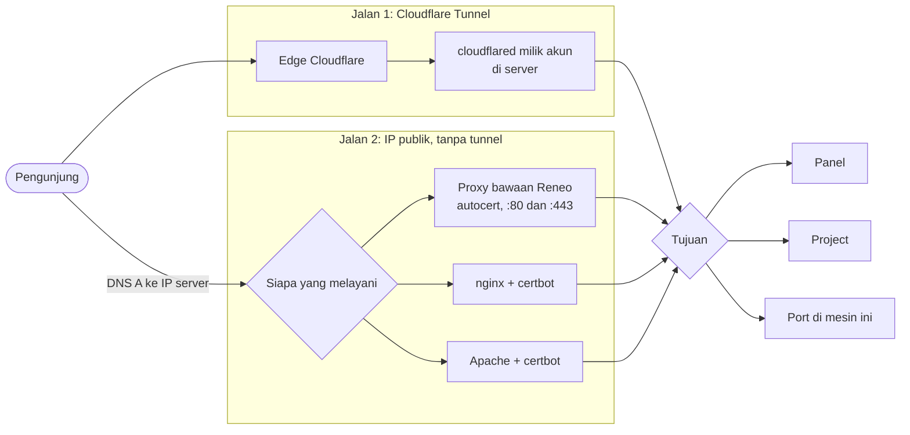
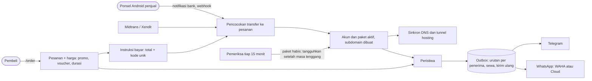
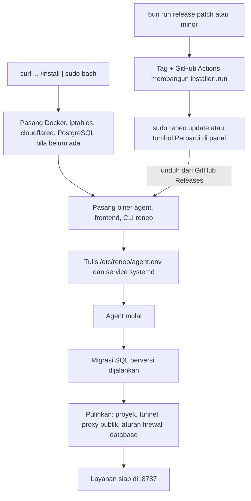

# Arsitektur Sistem Reneo

Gambaran rinci cara bagian-bagian Reneo bekerja sama. Diagram di README adalah ringkasannya. Dokumen ini memakai [Mermaid](https://mermaid.js.org); GitHub menggambarnya otomatis, sedangkan pratinjau Markdown bawaan editor perlu ekstensi Mermaid.

Struktur berkas ada di [repository-structure.md](repository-structure.md), struktur paket Go di [backend-go-structure.md](backend-go-structure.md), dan frontend di [frontend-structure.md](frontend-structure.md).

## 1. Komponen

Satu proses, `reneo-agent` (Go), menjalankan semuanya: menyajikan frontend, melayani API, mengawasi proses project, mengatur container, dan membuka port web publik. Agent berjalan sebagai service systemd dengan hak root.

## 2. Satu permintaan API

Semua keputusan akses dibuat di backend. Frontend hanya menyembunyikan apa yang tidak boleh dipakai akun itu.

Role: `superadmin`, `admin`, `user`, dan `demo` (hanya baca, endpoint baru ditolak secara bawaan). Admin hanya mengelola user biasa. Daftar bertabel (container, project, database, file, pengguna, dan lainnya) dihitung di backend: cari, urut, dan filter kolom dikerjakan `internal/listquery`, bukan di browser.

## 3. Project dan proses

Proses project dijalankan sebagai akun Linux pemiliknya (`runuser`), dengan environment minimal dan direktori kerja yang dikunci ke home pemilik.

Project satu proses memakai port yang dialokasikan dari blok milik akun dan terikat ke `127.0.0.1`. Tipe `stack` menjalankan beberapa proses di satu alamat lewat gateway. Variabel lingkungan project disimpan terenkripsi.

## 4. Database milik user dan aksesnya

Tiap database adalah container terpisah dengan volume sendiri, memakai port dari rentang `20000` sampai `29999`. Bawaannya hanya terbit di `127.0.0.1`.

Pembatasan memakai rantai `DOCKER-USER` karena port yang diterbitkan Docker melewati aturan `INPUT` ufw. Penjelasan lebih lengkap di [IP-PUBLIK.md](../IP-PUBLIK.md) dan artikel [mengelola-database](../articles/mengelola-database.md).

## 5. Domain dan alamat publik

Ada dua jalan agar sebuah domain sampai ke panel atau project, dan keduanya bisa dipakai bersamaan.

Pada jalan 2, ufw yang aktif harus membuka port web. Agent membukanya saat proxy dinyalakan, dan kartu IP publik menampilkan keadaannya. Domain pembeli: lewat Cloudflare for SaaS atau lewat server ini dengan bukti kepemilikan record TXT.

## 6. Hosting, pembayaran, dan notifikasi

## 7. Pemasangan, migrasi, dan pembaruan

## 8. Data

| Data | Tempat | Catatan |
| :--- | :--- | :--- |
| Akun, sesi, kuota, paket, pesanan, domain, rute publik, database user | PostgreSQL panel | Migrasi di `internal/database/migrations` |
| Rahasia (token Cloudflare, kredensial database user, variabel project, token bot) | PostgreSQL, terenkripsi dengan `PANEL_ENCRYPTION_KEY` | `internal/crypto` |
| Konfigurasi agent | `/etc/reneo/agent.env` | Dibuat installer |
| State agent (riwayat metrik, klien Ookla, dan lainnya) | `/var/lib/reneo` | |
| Isi database milik user | Volume Docker `reneo-db-<id>-data` | Satu volume per database |
| Tata letak widget, catatan, preferensi | PostgreSQL per akun, cache di localStorage browser | `GET/PUT /api/v1/me/widgets` |

Dokumen lanjutan: [Security Hardening](../security-hardening.md), [Database Migrations](../database-migrations.md), [Installer Architecture](../installer-architecture.md).
