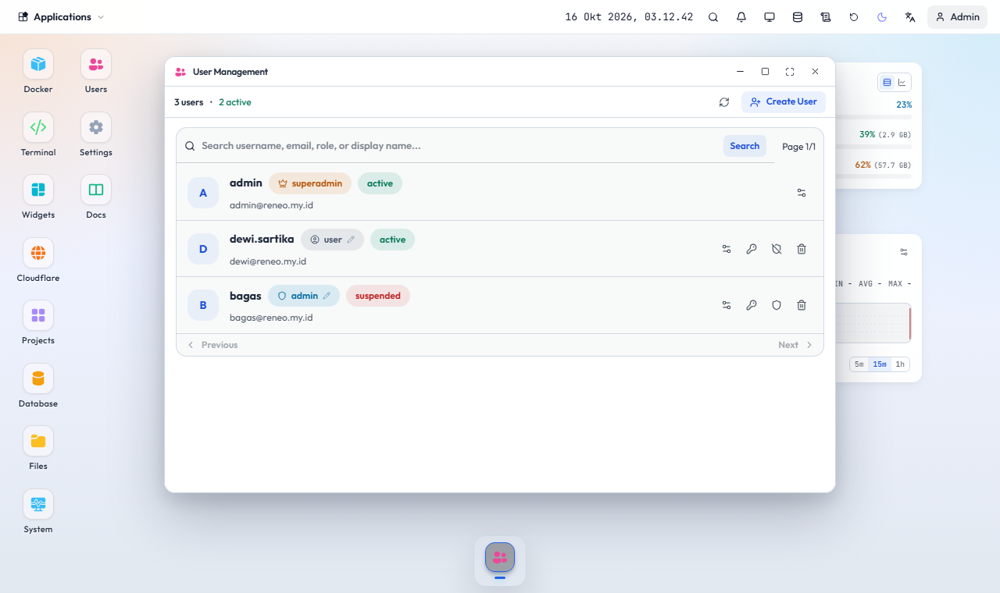

# Akun, kuota, dan akun demo

## Role

- **superadmin**: satu akun, mengelola semuanya termasuk pengaturan Reneo, database internal, dan log sistem.
- **admin**: mengelola user biasa, Docker, terminal, dan file sesuai kapabilitas. Tidak dapat mengubah admin lain atau superadmin.
- **user**: memakai project, database, tunnel, dan widget miliknya sendiri dalam kuota.

Hanya superadmin yang dapat memberi role admin. Tidak ada yang dapat mengubah role, status, atau menghapus dirinya sendiri.

## Kuota

Per akun: jumlah project, tunnel, database, disk, batas CPU, dan memori. Admin mengatur di window Users; pemakaian terhadap kuota tampil di panel yang sama dan di Profil user. Mengubah satu nilai tidak mengubah yang lain.

## Reset password

- Admin dapat mereset password user yang boleh dikelolanya (sesi user dikeluarkan).
- Setiap akun dapat mengganti password sendiri dari Profil.
- Suspend atau hapus user menghentikan project, tunnel, dan database miliknya.

## Akun demo

Aktifkan dengan `RENEO_DEMO_PASSWORD` di environment agent. Akun `demo` hanya membaca: melihat desktop, widget, ringkasan sistem, serta daftar project dan container miliknya. Terminal, file, pengaturan, user, database, log, dan semua aksi tulis ditolak. Username dan password tampil di landing page.
