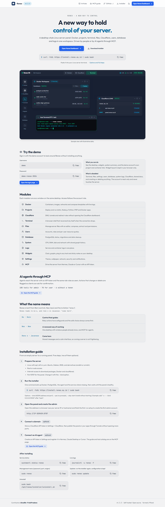
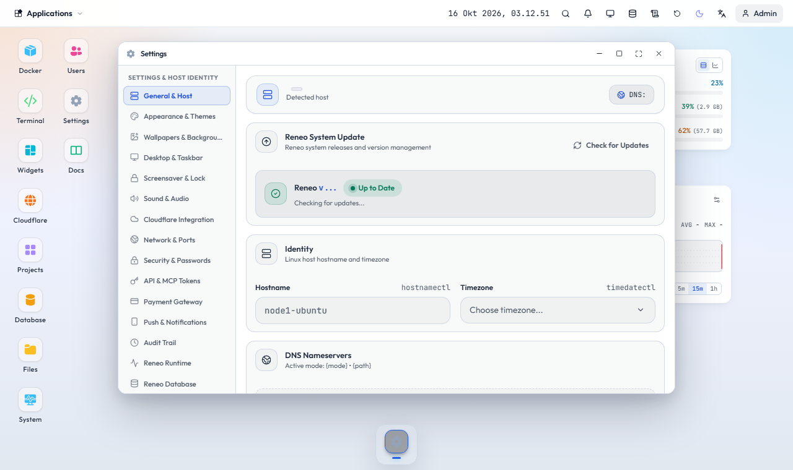

# Memasang Reneo di server Linux

Reneo dipasang dengan satu perintah. Jalankan di terminal server (Ubuntu, Debian, RHEL dan turunannya; amd64 atau arm64) sebagai root atau dengan sudo:

```bash
curl -fsSL https://install.reneo.my.id | sudo bash
```

Installer memasang bagian yang belum ada (Docker, PostgreSQL, cloudflared, klien Speedtest Ookla untuk jendela Speedtest), memasang agent, membuat service `reneo`, lalu menunggu panel sehat.



## Setelah terpasang

1. Buka `http://IP-SERVER:8787` di browser.
2. Selesaikan penyiapan pertama untuk membuat akun superadmin.
3. Masuk, lalu atur domain atau Cloudflare di Settings bila perlu.

## Opsi installer

- `--bind ADDR` mengubah alamat dan port panel.
- `--yes` menjalankan tanpa pertanyaan.
- `--skip-start` memasang tanpa menjalankan service.

Contoh port lain: `curl -fsSL https://install.reneo.my.id | sudo bash -s -- --bind 0.0.0.0:9000`.

Pengaturan port, origin, DNS, dan pembaruan ada di window Settings.



## Perintah sehari-hari

- `systemctl status reneo`: status service
- `journalctl -u reneo -f`: log langsung
- `sudo reneo`: menu pengelolaan (password, port, origin)
- `sudo reneo check-update`: cek versi baru
- `sudo reneo update`: perbarui panel, konfigurasi tetap

Panel juga bisa diperbarui dari Settings > Umum > Cek pembaruan.

## Mencopot

```bash
sudo bash /opt/reneo/installer/uninstall.sh
```

## Konfigurasi lewat environment

Nama `RENEO_*` diterima di mana pun nama `PANEL_*` dipakai. Yang sering dipakai:

- `RENEO_PUBLIC_URL`: alamat publik panel, dipakai untuk sitemap dan tautan kanonik
- `RENEO_DEMO_PASSWORD`: mengaktifkan akun demo hanya-baca
- `RENEO_UPDATE_CHECK=false`: mematikan cek pembaruan
- `RENEO_DOCS_SYNC=false`: mematikan sinkronisasi artikel resmi
