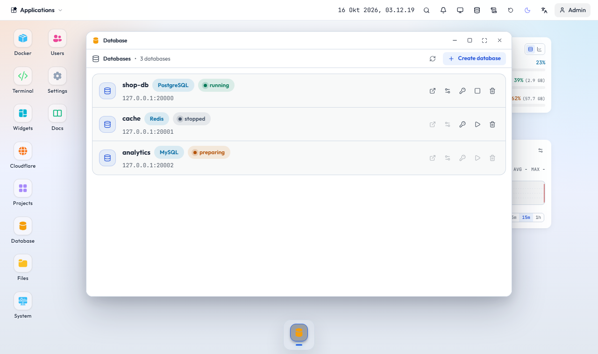

# Membuat dan mengelola database

Window **Database** membuat database milik Anda sendiri sebagai container terpisah: PostgreSQL, MySQL, MariaDB, MongoDB, dan Redis. Database Reneo sendiri tidak ikut tampil di sini.

## Membuat

1. Klik **Buat database**, pilih jenis, beri nama (huruf kecil, angka, strip), lalu pilih versi dari daftar (bawaan sudah terpilih).
2. Tunggu status berubah dari "menyiapkan" menjadi "berjalan". Image diunduh bila belum ada.
3. Buka **Info koneksi** untuk host, port, user, password, dan URL koneksi.

Database hanya dapat dijangkau dari server itu sendiri (`127.0.0.1`), misalnya oleh project Anda. Database tidak dibuka ke internet. Jumlahnya dibatasi kuota akun.

## Mengelola

Tombol **Kelola database** membuka:

- **Tabel**: daftar tabel, lihat isi per halaman, buat tabel lewat form kolom (tipe, primary key, boleh kosong, default), hapus tabel.
- **Konsol SQL**: jalankan pernyataan sebagai akun database itu (Ctrl+Enter). Untuk Redis berupa konsol perintah.
- **User & izin**: tambah user dengan hak baca saja, baca-tulis, atau penuh; hapus user.
- **Password**: ganti password akun utama atau buat yang acak. Perbarui juga konfigurasi project yang memakainya.

PostgreSQL, MySQL, dan MariaDB mendukung semua tab. Redis mendukung key dan konsol perintah serta penggantian password. MongoDB mendukung daftar koleksi dan penggantian password.

## Di window Docker dan di tab sendiri

- Container database juga tampil di window **Docker** dengan lencana "Database". Start, stop, restart, dan log bisa dari sana; hapus dan edit hanya dari window Database.
- Tombol **Buka di tab baru** membuka pengelola penuh di `/database/{id}` pada domain panel yang sama. Halaman itu tetap memakai login panel dan hanya dapat dibuka pemilik database.

## Menghapus

Menghapus database menghapus container dan volume datanya secara permanen. Konfirmasi selalu diminta.
