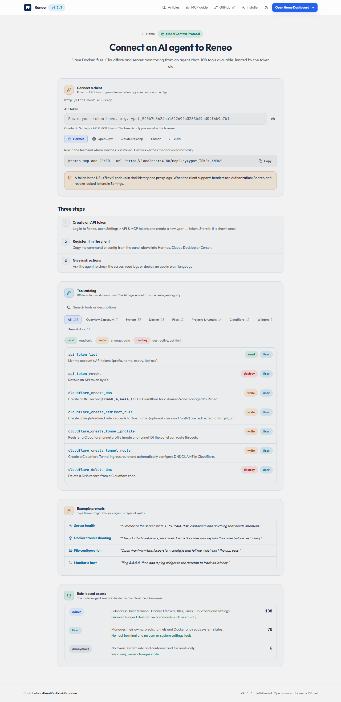

# Menghubungkan agen AI lewat MCP

Reneo menyediakan server Model Context Protocol (MCP) sehingga agen AI dapat memeriksa dan mengelola server dengan aturan role yang sama seperti pengguna.

## Langkah

1. Masuk ke panel, buka **Settings > API & MCP Tokens**, buat token baru.
2. Salin endpoint `https://domain-panel/mcp` dan token (diawali `ypat_`).
3. Tambahkan server MCP di klien Anda memakai header `Authorization: Bearer <token>`.
4. Minta agen: "periksa kesehatan server", "daftar container yang berjalan", atau "tunjukkan project yang perlu perhatian".
5. Contoh lain: "buat database PostgreSQL bernama shop", "tampilkan isi tabel orders", atau "jalankan update panel" (khusus superadmin).

Halaman [Panduan MCP](/docs/mcp) membuat konfigurasi siap salin untuk Hermes, OpenClaw, Claude Desktop, Cursor, dan cURL.

## Cakupan tool

Tool dikelompokkan menurut fitur: ringkasan dan akun, sistem, Docker, file, project dan tunnel, database (`db_*`), Cloudflare, widget, serta user dan dokumen. Daftar lengkap yang sedang aktif ada di halaman Panduan MCP, dan selalu dibuat dari registry agent.

## Hak akses

- Token mengikuti role akun pembuatnya. Superadmin dan admin mendapat tool terminal, file, Docker, dan Cloudflare; user biasa mendapat tool yang lebih terbatas.
- Tool yang mengubah atau menghapus ditandai agar klien dapat meminta konfirmasi.
- Beberapa tool dapat dipakai tanpa token (katalog dan info publik).

## Praktik aman

- Beri tiap agen token sendiri dan masa berlaku.
- Cabut token yang tidak dipakai di Settings.
- Jangan menaruh token di repository atau chat publik.
