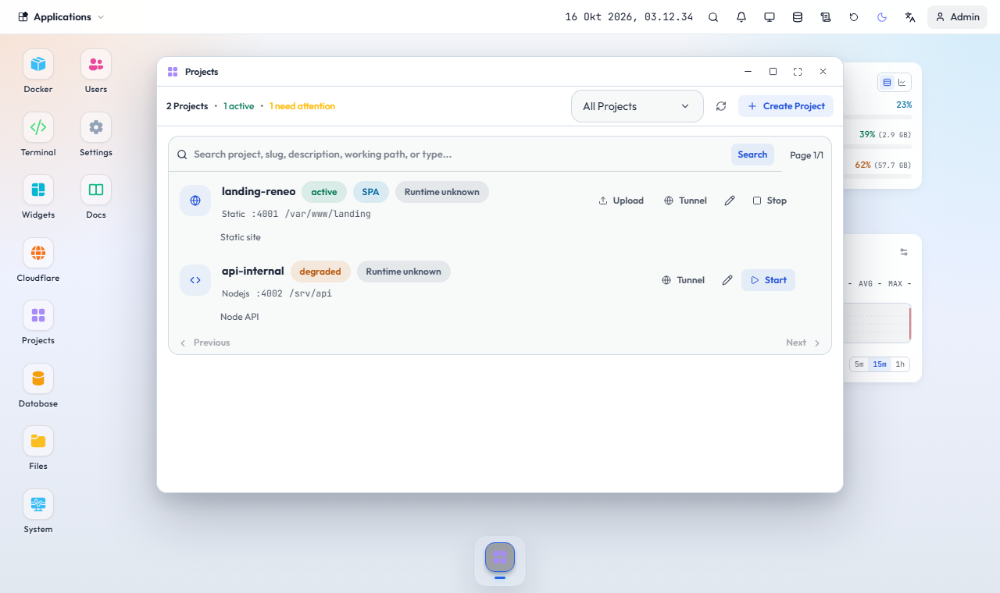

# Project dan runtime yang didukung

Window **Projects** menjalankan aplikasi Anda sebagai proses di bawah akun Linux pemiliknya. Tipe yang tersedia:

- `static`: melayani folder dengan `index.html`. Opsi SPA fallback mengarahkan rute tak dikenal ke `index.html`.
- `nodejs`: `npm start` bila ada `package.json`, selain itu `node index.js`.
- `python`: `gunicorn app:app` bila gunicorn terpasang, selain itu `python3 app.py`.
- `php`: `php -S` pada port project.
- `custom`: `start.sh` di direktori kerja.
- `stack` (Fullstack): beberapa proses dalam satu project, mis. frontend dan backend, di satu alamat. Lihat bagian di bawah.

Aplikasi harus mendengarkan di port dari variabel lingkungan `PORT`. Tiap akun mendapat blok 100 port; port bebas pertama dipakai untuk project baru.

## Perintah sendiri: install, build, start

Bila deteksi otomatis tidak cukup, isi tiga perintah di form project (tipe Node.js, Python, PHP, atau Custom):

- **Runtime**: pilihan cepat Node.js (npm), Bun, pnpm, atau Yarn yang mengisi ketiganya; boleh diubah.
- **Perintah install** dan **build** dijalankan sekali sebelum start. Tandanya disimpan di folder `.reneo/` project, jadi start berikutnya langsung menjalankan perintah start. Tombol **Pasang dan bangun ulang** di baris project menghapus tanda itu, menghentikan project, lalu menjalankan semuanya lagi.
- **Perintah start** menjalankan aplikasi dan harus mendengarkan di `PORT`. Contoh: `bun run start`, `node server.js`, `pm2-runtime ecosystem.config.js`. Perintah boleh berupa beberapa perintah yang digabung.
- Keluaran install, build, dan aplikasi ada di **Log** project. Install atau build yang gagal menghentikan proses dan Reneo mencoba lagi dengan jeda yang bertambah, seperti proses lain yang mati sendiri.

Bun, Node.js, pnpm, Yarn, dan pm2 dipasang per akun di Profil > Alat pengembangan, tanpa sudo; Reneo menaruhnya di depan `PATH` proses project. Reneo sendiri yang menjaga proses tetap hidup (restart otomatis, log, batas proses), jadi pm2 tidak wajib; ia tetap bisa dipakai sebagai perintah start lewat `pm2-runtime`.

**Variabel lingkungan** diisi satu per baris sebagai `KEY=VALUE`. Disimpan terenkripsi, nilainya disembunyikan di daftar project dan hanya tampil di form milik pemiliknya. `PATH`, `HOME`, `PORT`, dan variabel `LD_*` diatur panel dan tidak bisa diubah.

## Fullstack: beberapa proses, satu alamat

Pilih tipe **Fullstack** untuk frontend dan backend yang dijalankan bersama. Tiap proses punya nama, folder, jalur, dan perintahnya sendiri:

- **Jalur** `/` mengambil sisanya (frontend), `/api` mengambil backend. Permintaan masuk ke proses dengan jalur terpanjang yang cocok, dan awalan jalur ikut dikirim ke proses.
- **Proses** menjalankan perintah start di folder prosesnya, atau **Folder statis** menyajikan sebuah folder (mis. `dist` setelah build, dengan fallback ke `index.html` untuk aplikasi satu halaman).
- Port tiap proses dipilihkan Reneo dan diberikan lewat `PORT`; isi port bila aplikasi memakai port tetap. Satu port project (yang diberikan panel) melayani semuanya, jadi satu domain atau satu rute tunnel cukup.
- Paling banyak enam proses. Bila salah satu tidak menjawab, permintaan ke jalurnya mendapat 502 yang menyebut namanya, dan log project memuat keluaran tiap proses dengan namanya di depan.

Bila backend dan frontend lebih baik dipisah, buat dua project biasa dengan domainnya masing-masing.

## Aturan

- Direktori kerja harus berada di dalam direktori home akun Anda. Superadmin dapat memakai lokasi lain kecuali direktori sistem.
- Proses hanya menerima environment minimal (`PATH`, `LANG`, `PORT`, `TZ`). Rahasia panel tidak diteruskan.
- Untuk container, gunakan window Docker. Untuk rute publik ke layanan yang sudah ada, gunakan Cloudflare Tunnels.
- Project yang melewati batas kuota akun ditolak dengan pesan jelas.

## Publikasi

Hubungkan project ke domain lewat **Tunnel** di kartu project; Reneo membuat rute Cloudflare ke port project.
